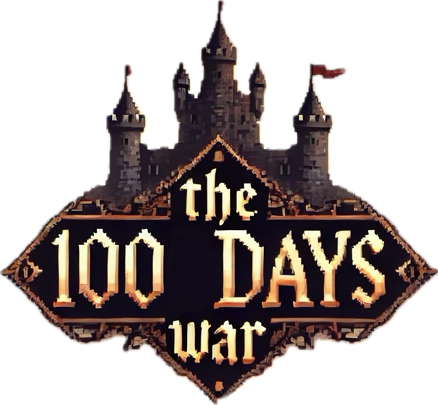

<p align="center">
  
</p>

# 100 Days War

**A single-player, turn-based strategy game built with Java and Swing.**


[](LICENSE)

Compete against a bot on a procedurally generated map. Manage coins, deploy soldiers and build defensive towers to capture the opponent's spawn cell or control the most territory after 100 virtual days.

Developed by a **team of four** for the **Object-Oriented Programming** course at the **University of Bologna**, academic year 2023/2024. Inspired by [Conq.io](https://www.conq.io/).

## My contribution

I implemented the **coin system and shop interface**, **game-map rendering** and **tower interaction logic**. This repository is my personal copy of the [original team repository](https://github.com/Gianmarco-Fabbri/OOP23-100DaysWar); the game is a collaborative project.

## Gameplay

- Procedurally generated maps with player and bot spawn points.
- A day and turn system with a limit of 100 virtual days.
- Coin-based purchasing and upgrades for soldiers and defensive towers.
- Soldier movement, pathfinding and level-dependent dice combat.
- A bot opponent, game statistics, save/load functionality and an in-game manual.
- Early victory by capturing the opponent's spawn cell, or a final comparison of controlled territory.

## Run locally

Use **JDK 21** and a desktop environment capable of displaying Swing windows. The bundled JAR contains Java 21 application classes, so Java 17 cannot run that artifact. The repository includes the Gradle wrapper; a separate Gradle installation is not required.

```bash
git clone https://github.com/Riccardo-Bartolini/OOP-100Days_War.git
cd OOP-100Days_War
```

**macOS / Linux**

```bash
bash ./gradlew run
```

**Windows**

```powershell
.\gradlew.bat run
```

The first Gradle run requires internet access to download the wrapper distribution and dependencies.

### Included JAR

From the repository root:

```bash
java -jar OOP23-100DaysWar-all.jar
```

### Build and test

```bash
bash ./gradlew test
bash ./gradlew shadowJar
```

The executable JAR is generated under `build/libs/`. On Windows, use `.\gradlew.bat` in place of `bash ./gradlew`.

The source includes JUnit 5 tests covering model behavior and controller interactions. 

## Architecture

The application follows **Model–View–Controller**, separating game state, user actions and the Swing interface.


| Component | Responsibility |
| :--- | :--- |
| Model | Map, players, units, combat, turns, economy, statistics and persistence. |
| View | Menus, map rendering, shop, statistics and game feedback. |
| Controller | Coordinates user actions and updates across the model and interface. |

See [`src/main/java/`](src/main/java/) for implementation, [`src/test/java/`](src/test/java/) for tests and the [project report](Report.pdf) for the original design documentation.

## Team and responsibilities

| Member | Contribution |
| :--- | :--- |
| [Riccardo Bartolini](https://github.com/Riccardo-Bartolini) | Coin system and shop interface; map rendering; tower interaction logic. |
| [Riccardo Balzani](https://github.com/FrittatinaDiBucatini09) | Towers, dice system and start menu; save and load functionality. |
| [Gianmarco Fabbri](https://github.com/Gianmarco-Fabbri) | Soldiers and their interactions; bot opponent; real-time statistics. |
| [Filippo Francalanci](https://github.com/FrancalanciFilippo) | Combat, turn progression, in-game manual and end-game conditions. |

## License and provenance

The project retains the [MIT License](LICENSE) and original copyright notice from the team repository. Team credits are preserved above. Bundled dependencies and assets may have their own terms; the project license does not replace third-party notices.
